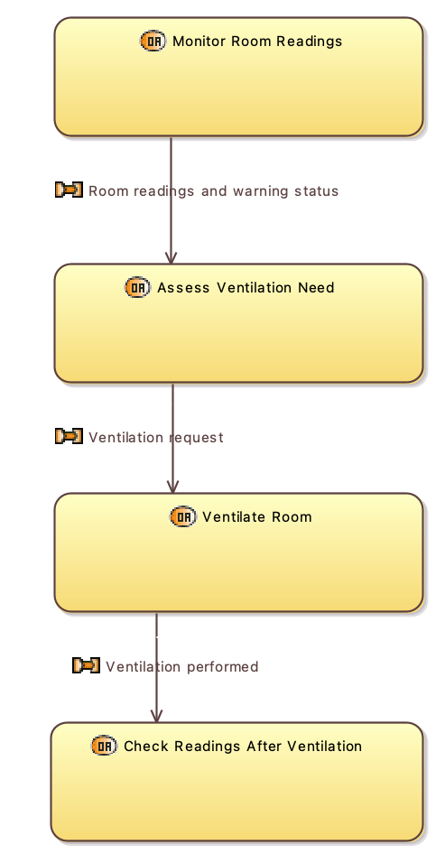
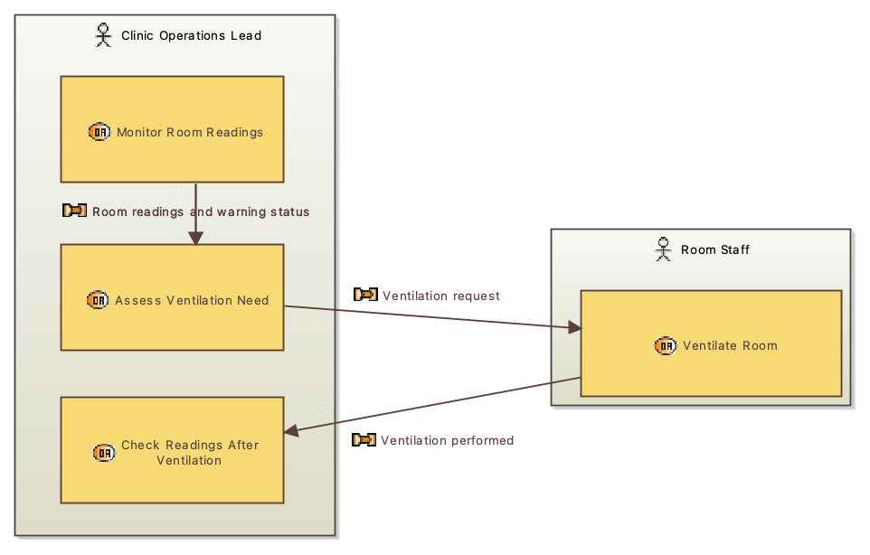
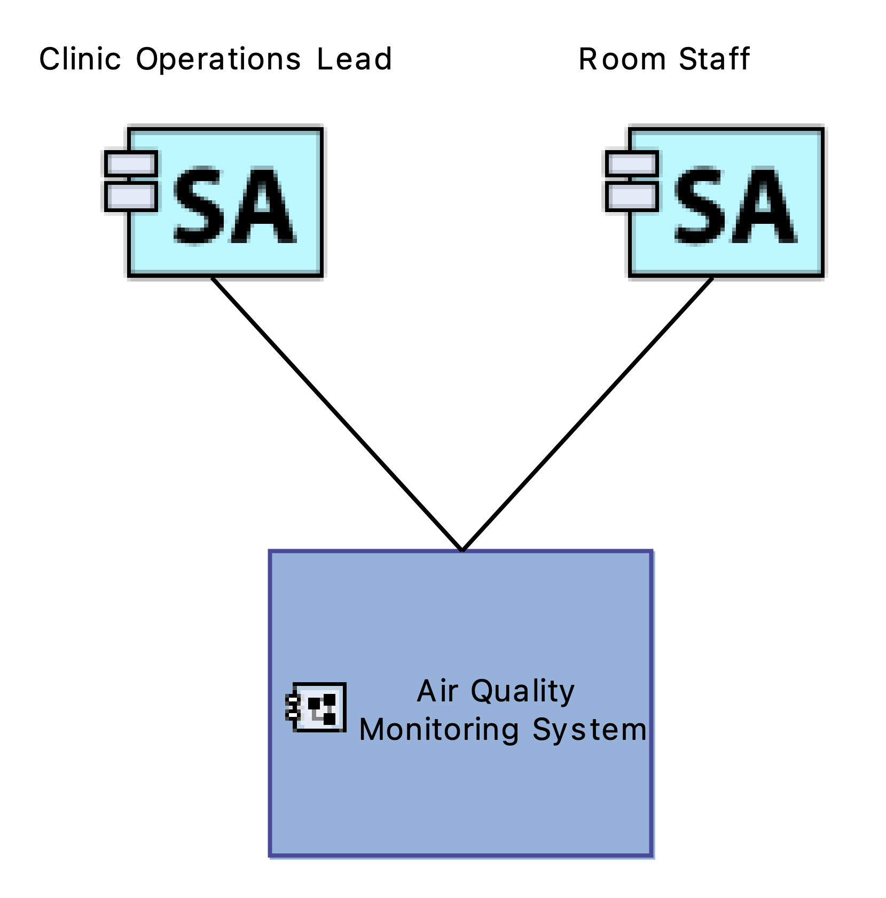
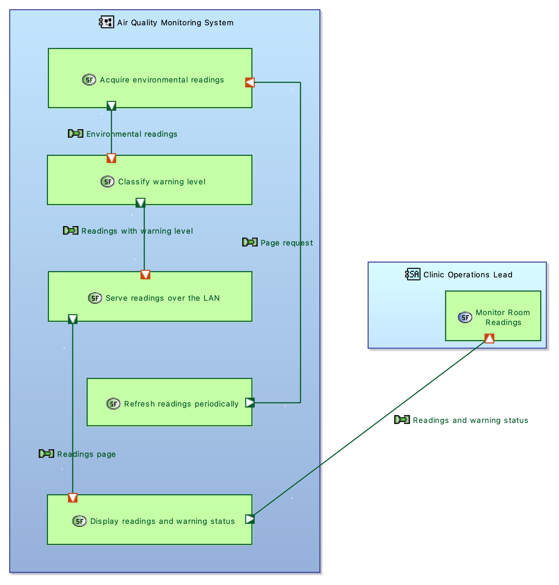

# Systems engineering model (retrospective)

This folder holds a small model-based systems engineering (MBSE) view of the Air Quality Monitor, built in [Capella](https://mbse-capella.org/) 7.1.0 using the Arcadia method. It was made **retrospectively in November 2026**, after the device had been built and used, to document the design intent and the boundary between the system and the people who act on it. It covers the first two Arcadia layers only: Operational Analysis and System Analysis.

## 1. Operational need

The monitors were used in a clinic to decide when rooms needed fresh air. The operations lead watched the readings in a browser, decided when ventilation was needed, and asked room staff to open the windows; readings were then checked again. The system informs; people act.

*Operational activities and the information exchanged between them.*

*Who performs each activity. Ventilation is a human activity, outside the system.*

## 2. System context

The system is treated as a black box with two external actors: the Clinic Operations Lead and the Room Staff.

## 3. System functions

| Function | What it does | Where it lives in the code |
|---|---|---|
| Refresh readings periodically | The served page asks the browser to reload every 60 s | `html_header(..., "60")` sends an HTTP `Refresh: 60` header |
| Acquire environmental readings | Reads eCO₂ and TVOC (CCS811) and temperature, humidity and pressure (BME280) | `print_sparkfun_ccs811()`, `print_sparkfun_bme280()` |
| Classify warning level | Labels eCO₂ as green (< 700 ppm), yellow (700–999 ppm) or red (≥ 1000 ppm) | `sparkfun_ccs811.h` |
| Serve readings over the LAN | Builds and returns the HTML page over the wired Ethernet LAN | `loop()` in `air_quality_monitor.ino`, `sensor_server.h` |
| Display readings and warning status | Shows the values and colour-coded warning in the browser | HTML generated by the firmware |

Sensors are read **on each page request**, not continuously: every browser refresh triggers a new acquisition, classification and response.

## 4. The boundary

The only exchange that leaves the system is *Readings and warning status*, from the display to the operations lead. Assessing the need, requesting ventilation, opening the windows and checking the result are human activities in the operational layer. Keeping them out of the system makes its requirements simple and testable, while procedures cover the human part.

## 5. Limits

- eCO₂ is an estimate calculated by the CCS811's metal-oxide gas sensor, not a direct CO₂ measurement, and the device does not detect infection.
- Logical and physical architecture layers were not modelled.
- The Capella project files are not included; this folder documents the model through exported diagrams.
